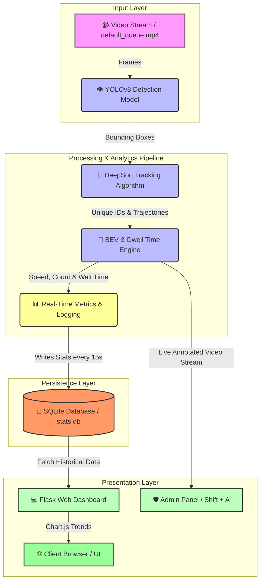

<div align="center">

# AI-Powered Temple Queue Management System
### Real-Time Queue Density Monitoring & Crowd Analytics Engine
**An AI-driven computer vision framework for intelligent crowd flow optimization, wait-time estimation, and live surveillance.**

[](https://www.python.org/)
[](https://flask.palletsprojects.com/)
[](https://github.com/ultralytics/ultralytics)
[](https://opencv.org/)
[](https://www.sqlite.org/)
[](https://opensource.org/licenses/MIT)

[Description](#-description) • [Features](#-features) • [System Architecture](#-system-architecture) • [Tech Stack](#-tech-stack) • [Quick Start](#-quick-start) • [How to Run](#-how-to-run) • [Project Structure](#-project-structure) • [Contributing](#-contributing) • [License](#-license)

</div>

---

## Description

This project provides a real-time system for monitoring and analyzing queue density and wait times using computer vision. It leverages the YOLOv8 object detection model and DeepSort tracking algorithm to count people within a defined zone in a video stream, calculate average speed, estimate dwell time, and provide historical analytics. The system includes a web-based dashboard built with Flask for live monitoring and an admin panel for viewing the processed video feed.

---

## Features

- **Real-Time People Counting:** Detects and counts people within a designated queue zone using YOLOv8.
- **Object Tracking:** Uses DeepSort to assign unique IDs and track individuals across frames.
- **Accurate Dwell Time Calculation:** Measures the actual average time people spend within the queue zone.
- **Bird's-Eye View (BEV) Speed Calculation:** Implements perspective transformation for accurate speed estimation, correcting for camera distortion.
- **Historical Data Logging:** Records people count and wait time statistics to an SQLite database every 15 seconds.
- **Web Dashboard:** Displays live statistics (People Count, Avg. Wait Time, Avg. Speed, Queue Status) via a Flask web application.
- **Historical Charting:** Visualizes the historical trend of people count and wait time using Chart.js.
- **Alerting System:** Changes the header color to red when the live people count exceeds a configurable threshold.
- **Admin Panel:** Provides a view of the live processed video stream with detection boxes (Access via `Shift+A`).
- **Showcase Notebook (`project.ipynb`):** Demonstrates the core computer vision steps (detection, BEV transform) interactively.

---

## System Architecture


---

## Tech Stack

* **Backend:** Python, Flask
* **Computer Vision:** OpenCV, Ultralytics YOLOv8, DeepSort Realtime
* **Database:** SQLite
* **Frontend:** HTML, CSS, JavaScript, Chart.js
* **Environment:** Jupyter Notebook (for showcase)

---

## 🚀 Quick Start

### 1. Clone the Repository

```bash
git clone https://github.com/Rahul-sg123/yolo-detetction-mini-project
cd yolo-detection-mini-project

```

### 2. Create a Virtual Environment (Recommended)

```bash
python -m venv venv
.\venv\Scripts\activate  # On Linux/macOS use: source venv/bin/activate

```

### 3. Install Dependencies

```bash
pip install -r requirements.txt

```

### 4. Setup Input Video

Ensure you have a video file named `default_queue.mp4` inside the `uploads` folder.

### 5. (Optional) Calibrate Bird's-Eye View

If using a different video, run `python get_coordinates.py`, click the 4 floor corners, and update `SOURCE_POINTS` and `REAL_WORLD_WIDTH_METERS` in `video_processor.py`.

---

## How to Run

1. **Start the Flask Application:**
```bash
python app.py

```


2. **Access the Dashboard:**
Open your web browser and navigate to `http://127.0.0.1:5000`.
3. **View Live Video Feed:**
Press `Shift + A` on the webpage to open the Admin Panel.
4. **View Showcase Notebook:**
Run `jupyter notebook` or `jupyter lab` in your terminal from the project directory and open `project_showcase.ipynb`.

---

## Project Structure

```text
your-project-folder/
├── app.py              # Flask web server application
├── video_processor.py      # Core CV logic (YOLO, DeepSort, BEV, Dwell Time)
├── get_coordinates.py      # Helper script for BEV calibration
├── requirements.txt        # Python dependencies
├── README.md               # This documentation file
├── stats.db                # SQLite database (created automatically)
├── Notebooks/
│    └── project.ipynb       # Jupyter notebook for demonstration
├── uploads/
│    └── default_queue.mp4   # The default video file to process
└── templates/
     └── index.html          # Frontend HTML dashboard

```


---

## 🤝 Contributing

Contributions are always welcome! Whether it's reporting a bug, improving documentation, or proposing a new feature, your help makes this project better.

1. Fork the Project
2. Create your Feature Branch (`git checkout -b feature/AmazingFeature`)
3. Commit your Changes (`git commit -m 'Add some AmazingFeature'`)
4. Push to the Branch (`git push origin feature/AmazingFeature`)
5. Open a Pull Request

---

## License

Distributed under the **MIT License**. See `LICENSE` file for more information.

---

## Support & Contact

If you have any questions, issues, or suggestions, feel free to open an issue in the repository or reach out.
